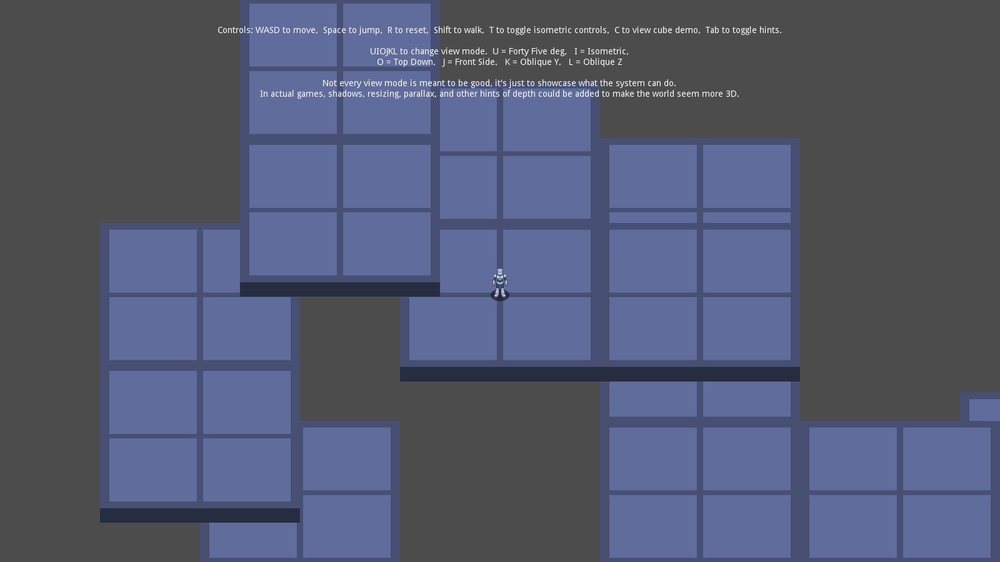
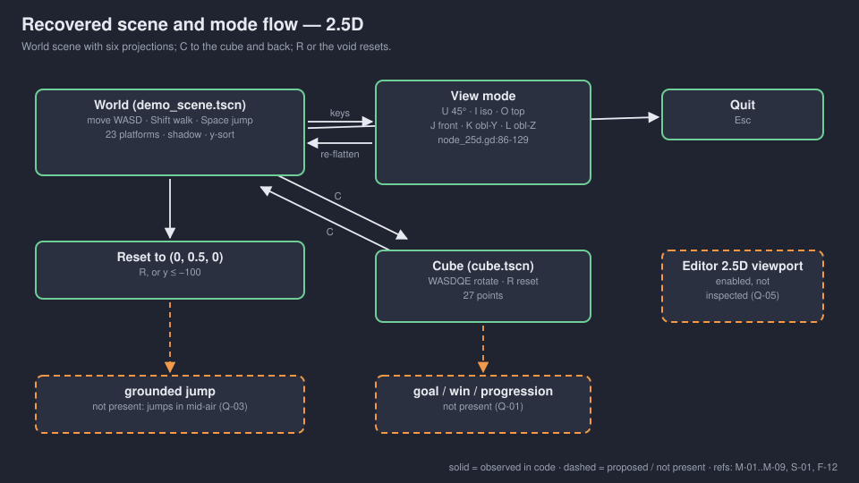
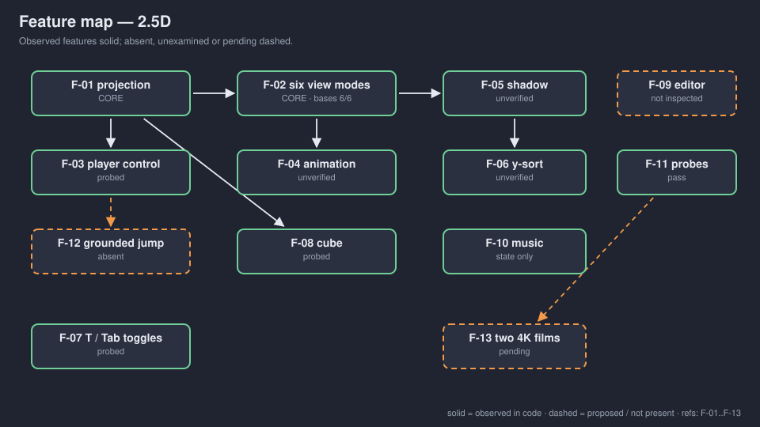

# walker-misc-2-5d — Game Design Document (recovered)

| | |
|---|---|
| Version | 0.1.0-recovered |
| Date | 2026-09-27 |
| Author | Zelda (agent, silent) for Nik Bear Brown |
| Command | `/gdd reverse --path godot silent` |
| Mode | recovered |
| Revision | 1 |
| Gates | gate — unsigned at time of writing (vision ○ · systems ○ · world ○ · scope ○) |
| Source | GDScript adaptation of Godot demo `misc/2.5d`, upstream checkout `a3b5c11` `[OBSERVED README.md:3-4]` |
| Verdict | **Tech demo with a playable sandbox.** A character runs and jumps across floating platforms under six switchable projections, plus a rotating-cube scene and an editor plugin. No goal, win, fail or progression; falling off resets you. |

Provenance tags: `[OBSERVED path:line]` the code does this · `[INFERRED]` implied, evidence stated · `[MISSING]` the code cannot say; each is an open question in `decisions.md`. Code paths are relative to `godot/`. A recovered GDD describes what exists; it approves nothing. Image and diagram links are relative to `design/`; the root `GDD.md` is an identical copy, so open `design/GDD.md` or `design/DECK.html` to see the pictures.

*Upstream screenshot referenced by `godot/README.md:29`, one of seven retained from the source demo `[INFERRED: listed in the upstream README, 1600×900]`. Not a Walker capture. Walker has verified runtime basis state headlessly; rendered sprite alignment, shadows and occlusion are unverified `[OBSERVED FRICTIONAL.md; CAPTURE-PLAN.md]`.*

## 1. Vision summary

**What exists.** A 2.5D system built from a plugin (`addons/node25d`): each `Node25D` has a 3D physics child (for math only) and a 2D sprite; a 2D position is computed from the 3D position through three basis vectors `[OBSERVED node_25d.gd:1-63; godot/README.md:17-21]`. The demo scene has a player, a projected shadow, 23 static platforms, a Y-sort node, an overlay and looping music `[OBSERVED demo_scene.tscn:21-477]`. Six keys switch the projection (45°, isometric, top-down, front, oblique Y, oblique Z) `[OBSERVED node_25d.gd:86-129]`. `C` opens a second scene: a 27-point cube you rotate `[OBSERVED cube_math.gd]`. An editor main screen adds a 2.5D viewport for level editing `[OBSERVED node25d_plugin.gd; main_screen/viewport_25d.gd]`.

**What it teaches.** "A 2.5D game in Godot by mixing 2D and 3D nodes": physics in 3D, rendering in 2D, the view as a matrix you can swap `[OBSERVED godot/README.md:3-5,17-21]`. The overlay says so plainly: "Not every view mode is meant to be good" `[OBSERVED assets/ui/overlay.tscn:22]`.

**Walker's change.** Title only `[OBSERVED README.md:4; project.godot:13]`. Two headless probes were added (`test_modes.gd`, `test_runtime_cleanup.gd`) `[OBSERVED godot/]`.

**Why it is in Walker / for whom.** `[MISSING → Q-01, Q-02]`. It is the only demo in this batch with a controllable character in a space, so it is the likeliest to be mistaken for a game seed; nothing says it is one.

**Player fantasy.** None stated `[MISSING → Q-01]`. The sandbox supports "run and jump across floating blocks"; that is an activity, not a fantasy, and no lore is invented here.

**Biggest unresolved question.** Is this a projection lesson (keep six modes, the cube and the editor) or a platformer foundation (one mode, grounded jumps, goals)? The code is the former. Q-01.

## 2. Design pillars

None stated `[MISSING → Q-01]`. Readings `[INFERRED]`:

| ID | Inferred pillar | Evidence |
|---|---|---|
| P-01 | 3D decides, 2D draws | math bodies are `CharacterBody3D`/`StaticBody3D`, camera and sprites 2D `godot/README.md:21` |
| P-02 | The view is a swappable matrix | six basis sets `node_25d.gd:86-111` |
| P-03 | Show, don't polish | "Not every view mode is meant to be good" `overlay.tscn:22` |

## 3. Core loop

**Moment.** Move (WASD, Shift halves speed), jump (Space), watch the sprite, shadow and sort order follow `[OBSERVED player_math_25d.gd:31-60; shadow_math_25d.gd:29-42; y_sort_25d.gd]`.
**Minute.** Switch projection (U/I/O/J/K/L) and see the same world re-flattened; toggle isometric controls (T) and hints (Tab) `[OBSERVED node_25d.gd:116-129; player_math_25d.gd:20-21; control_hints.gd:4-6]`.
**Session.** C to the cube and back; Esc quits `[OBSERVED player_math_25d.gd:13-18; cube_math.gd:29-34]`. Fall below y = −100 or press R to reset `[OBSERVED player_math_25d.gd:22-25]`. No end state exists.

## 4. Player Experience Goals

`[MISSING → Q-02]` Candidate outcomes `[INFERRED]`, not decided:

| ID | Candidate outcome | Evidence |
|---|---|---|
| PX-01 | See that one 3D layout yields six 2D views by changing three vectors | six modes, one scene |
| PX-02 | Understand why the shadow is a downward shapecast, not a drawn blob | `shadow_math_25d.gd:1-3,29-42` |
| PX-03 | Know that flat projections hide depth; hidden geometry still exists | CAPTURE-PLAN.md "Do not claim hidden geometry ceased to exist" |

## 5. Mechanics

### M-01 Move `[OBSERVED player_math_25d.gd:31-48]`
`Input.get_vector(move_left, move_right, move_forward, move_back)`, velocity × 10 units/s, halved while `movement_modifier` (Shift) is held; `move_and_slide()` on the `CharacterBody3D`. Walker probe: Shift+D 1.0 unit vs D 2.0 units over 24 physics frames `[OBSERVED FRICTIONAL.md 03:03]`.

### M-02 Isometric controls `[OBSERVED player_math_25d.gd:20-21,36-38]`
In isometric mode, with isometric controls on (default), input axes rotate 45° so "up" moves up-screen. T toggles.

### M-03 Jump and gravity `[OBSERVED player_math_25d.gd:52-60]`
Space sets vertical speed 60; gravity 240/s²; collision zeroes vertical speed. **There is no grounded check: jump works in mid-air** `[OBSERVED :53-54; CAPTURE-PLAN.md]`. Whether that is intended is `[MISSING → Q-03]`.

### M-04 Reset and void `[OBSERVED player_math_25d.gd:22-25]`
R, or falling to y ≤ −100, snaps the player to (0, 0.5, 0) with zero vertical speed.

### M-05 View modes `[OBSERVED node_25d.gd:84-129; player_sprite.gd:52-89]`
U 45° · I isometric · O top-down · J front · K oblique Y · L oblique Z. Every `Node25D` polls the keys itself; the player sprite also re-skews its own 2D transform. Walker probe: all six bases match within 0.001 `[OBSERVED FRICTIONAL.md 01:28]`. The cube overlay's hint omits J (Front Side) though J still works there `[OBSERVED assets/ui/overlay_cube.tscn:20-21 vs node_25d.gd:124-125]`.

### M-06 Sprite animation `[OBSERVED player_sprite.gd:5,22-50]`
15 fps; ground probe by test-only `move_and_collide`; run (6 frames × direction), stand (1 × direction), jump (2 × direction: rising/falling); Shift halves animation speed.

### M-07 Shadow `[OBSERVED shadow_math_25d.gd:14-42]`
`ShapeCast3D` follows the previous sibling's 3D child and casts down; visible only while it hits something.

### M-08 Depth sort `[OBSERVED y_sort_25d.gd:11-47; node_25d.gd:133-140]`
Sorts `Node25D` children by y with a 0.001·(x+z) tiebreak, one frame late; capped at 4000 sorted nodes per the comment `[:47]`.

### M-09 Cube demo `[OBSERVED cube_math.gd:12-53]`
27 points on a 3×3×3 lattice at spacing 5; W/S rotate X, A/D rotate Y, Q/E rotate Z; R resets; C returns. Walker probe: each key changes the basis from identity (angles not asserted) `[OBSERVED FRICTIONAL.md 03:03]`.

### M-10 Music `[OBSERVED demo_scene.tscn:474-477]`
`mr_mrs_robot.ogg`, −20 dB, autoplay. Playing state checked; never listened to `[OBSERVED FRICTIONAL.md]`.

Tuning values (recorded, not approved): `Node25D.SCALE` 32 px per unit `[node_25d.gd:10]`; move 10 u/s, walk 5 u/s; jump 60, gravity 240; void −100; spawn y 0.5; physics 120 Hz `[project.godot:160]`; viewport 1600×900 `[:28-29]`; nearest texture filter `[:164]`.

## 6. Systems

### S-01 Node25D projection `[OBSERVED node_25d.gd]`
`global_position = x·basisX + y·basisY + z·basisZ` every `_process` `[:53-63]`. `@tool`, so it also runs in the editor. A struct version (`Basis25D`, `Transform25D`) exists only in `.broken-gdscripts/` because GDScript rejected it `[OBSERVED node_25d.gd:21-24]`.

### S-02 Input map `[OBSERVED project.godot:37-156]`

| Action | Key | Joypad |
|---|---|---|
| move_right / left / forward / back | D / A / W / S, arrows | left stick |
| movement_modifier | Shift | button 1 |
| jump | Space | button 0 |
| reset_position | R | button 3 |
| forty_five / isometric / top_down / front_side | U / I / O / J | buttons 13 / 15 / 12 / 14 |
| oblique_y / oblique_z | K / L | buttons 4 / 5 |
| toggle_isometric_controls | T | button 8 |
| toggle_control_hints | Tab | button 10 |
| move_clockwise / counterclockwise | E / Q | buttons 7 / 6 |
| view_cube_demo | C | button 2 |
| exit | Esc | button 11 |

Controller input is untested `[OBSERVED absence in FRICTIONAL.md]`.

### S-03 Editor plugin `[OBSERVED node25d_plugin.gd:10-55; main_screen/*; plugin.cfg]`
Registers the custom types and a "2.5D" main screen with its own viewport, gizmos and zoom. Enabled in `project.godot:35`. Not inspected or exercised by Walker: "Editor plugin and remaining runtime scripts need further inspection" `[OBSERVED FRICTIONAL.md 00:24]`.

### S-04 Shutdown `[OBSERVED FRICTIONAL.md 00:24-00:56]`
A plain 120-frame run reported 4 leaked ObjectDB instances and 2 resources in use; stopping music, draining 200 ms and freeing the scene exits cleanly. The abrupt-exit warning is "documented, not silently fixed" `[OBSERVED CAPTURE-PLAN.md]`.

## 7. Progression

None `[OBSERVED absence]`. No collectibles, levels, score or unlocks.

## 8. World

One demo scene of 23 static platform blocks, plus the cube scene `[OBSERVED demo_scene.tscn: 23 StaticBody3D]`. Clear colour dark navy `(0.08, 0.11, 0.22)` `[project.godot:167]`. Platform, player and shadow textures exist once per view mode (six each for platform and shadow) `[OBSERVED assets/*/textures/]`. No level intent is recorded; the layout is a playground `[INFERRED: no goals or markers in the scene]`.

## 9. Narrative

None `[OBSERVED absence]`.

## 10. Characters

One unnamed player figure (stand/run/jump sheets) `[OBSERVED assets/player/textures/]`. No name, role or story; none is invented.

## 11. Features and priority

Tags are Zelda's reading of what the demo teaches `[INFERRED]`, provisional.

| ID | Feature | Tag | Paths | Status |
|---|---|---|---|---|
| F-01 | Node25D projection | CORE | `addons/node25d/node_25d.gd` | done; basis state verified |
| F-02 | Six view modes | CORE | `node_25d.gd:86-129`, `player_sprite.gd:52-89` | done; 6/6 bases match; visuals unverified |
| F-03 | Player move / walk / jump / reset | IMPORTANT | `player_math_25d.gd` | done; D, Shift, Space, R probed |
| F-04 | Sprite animation by direction | IMPORTANT | `player_sprite.gd` | present; unverified |
| F-05 | Shadow shapecast | IMPORTANT | `shadow_math_25d.gd` | present; unverified visually |
| F-06 | Y-sort 25D | IMPORTANT | `y_sort_25d.gd` | present; unverified visually |
| F-07 | Isometric-controls and hint toggles | NICE | `player_math_25d.gd:20-21`, `control_hints.gd` | done; T and Tab probed |
| F-08 | Cube demo | NICE | `assets/cube/` | done; 27 points, 6 keys, reset probed |
| F-09 | 2.5D editor viewport plugin | IMPORTANT | `addons/node25d/main_screen/`, `node25d_plugin.gd` | present; not inspected or exercised |
| F-10 | Music | NICE | `demo_scene.tscn:474-477` | playing state only |
| F-11 | Headless probes | IMPORTANT | `test_modes.gd`, `test_runtime_cleanup.gd` | pass (session exit codes in FRICTIONAL.md) |
| F-12 | Grounded jump | — | — | absent (Q-03) |
| F-13 | Two native-4K Liam films | IMPORTANT (Walker process) | `CAPTURE-PLAN.md` | pending |

**CORE percentage: 2 of 13 = 15%.** Under 40%.

## 12. Out of scope

| Item | Reason | Decided |
|---|---|---|
| The C# version | "This is the GDScript demo, not its separate C# counterpart" `[OBSERVED README.md:13]` | Walker copy |
| A rendered 3D camera | README states physics drives 2D sprites through basis vectors, not a rendered 3D camera `[OBSERVED README.md:10-11]` | upstream design |
| Fixing the struct Basis25D | engine limitation, kept in `.broken-gdscripts/` | upstream |
| Goals, enemies, levels | none present | `[MISSING → Q-01]` |

## 13. Technical

Godot 4.7 feature tag `[OBSERVED project.godot:19]`. Renderer GL Compatibility `[:165-166]`, physics 120 Hz `[:160]`, viewport 1600×900, stretch `canvas_items`/`expand` `[:28-31]`, nearest filtering `[:164]`. Main scene `res://assets/demo_scene.tscn` `[:18]`. Editor plugin enabled `[:35]`. Custom classes: `Node25D`, `ShadowMath25D`, `PlayerMath25D`, `YSort25D` (via plugin). Exported vars: `Node25D.spatial_position` (Vector3) `[node_25d.gd:13]`, `YSort25D.sort_enabled` `[y_sort_25d.gd:12]`. No named collision layers. Assets: 3 player sheets, 6 platform + 6 shadow view textures, cube textures, 9 plugin icons, 1 OGG, 7 upstream screenshots.

Credits `[OBSERVED README.md:7-8; godot/README.md]`: code MIT; music `assets/mr_mrs_robot.ogg` CC-BY Attribution, credited upstream to Juan Linietsky (circa 2008), to be preserved in film descriptions.

## 14. Risks

| ID | Risk | Cat | L/I | Mitigation |
|---|---|---|---|---|
| R-01 | Sandbox mistaken for a platformer seed; infinite air-jump copied as a mechanic | Design | M/M | Q-01, Q-03 |
| R-02 | Headless basis checks read as visual verification of alignment, shadows and occlusion | Process | H/M | keep CAPTURE-PLAN wording: transform tests alone cannot establish layering |
| R-03 | Editor plugin shown in a film without inspection | Process | M/M | CAPTURE-PLAN item 7; S-03 |
| R-04 | Abrupt-exit leak warning resurfaces in capture | Technical | M/L | use the documented stop/drain path |
| R-05 | Music attribution dropped from film descriptions | Legal | L/M | Q-06 |

**Top 3.** R-02, R-01, R-03.

## 15. Open questions

In `decisions.md`: Q-01 projection lesson or platformer foundation; Q-02 learner outcomes; Q-03 air-jump intended or bug; Q-04 fix the cube hint's missing J or leave upstream text; Q-05 editor-plugin scope for films; Q-06 music credit wording in descriptions; Q-07 definition of done and who signs.

## 16. Tests

Existing `[OBSERVED godot/test_runtime_cleanup.gd, test_modes.gd; FRICTIONAL.md]` (no Walker log files are stored in this folder; results are recorded as session notes in FRICTIONAL.md):
- D moves x to 2.0 in 24 physics frames; R restores x/z near 0; Shift+D 1.0 vs 2.0; Space raises height > 1 in 8 frames; U/I/O/J/K/L bases within 0.001; music playing state true (not listened).
- T toggle/restore; Tab hide/show; C to cube and back; 27 cube points; D changes basis, R restores identity; W/S/A/D/Q/E each change basis from identity.
- Clean exit via stop music → 200 ms drain → free scene.

Proposed:

| ID | Setup | Action | Expected | Links |
|---|---|---|---|---|
| T-40 | player airborne | press Space | per Q-03: no jump (if grounded-only) or documented air-jump | M-03 |
| T-41 | each view mode, visible window | capture | sprite sits on platform, shadow under player, sort correct | F-02, F-05, F-06 |
| T-42 | editor | open 2.5D main screen, move a gizmo | spatial_position updates | F-09 |
| H-01 | a learner | switch all six modes | explains basis vectors in their own words | PX-01 |

## Zelda's read — 7 failure modes

| Mode | Rating | Evidence |
|---|---|---|
| Ghost Center | PRESENT (expected) | §1 purpose and fantasy `[MISSING]` |
| Mechanic Mirage | PRESENT (expected) | §4 outcomes describe the technique |
| Implementation Void | PARTIAL | runtime state well probed; visuals, editor plugin, controller and air-jump intent are not |
| Priority Inflation | ABSENT | CORE 15% |
| Novelist's Trap | ABSENT | no lore; none added |
| Completeness Fallacy | PARTIAL | editor plugin and capture requirements live only in CAPTURE-PLAN.md prose |
| Stagnant Artifact | ABSENT | dated FRICTIONAL.md; CHANGELOG.md starts here |

## Zelda's notes (silent mode; what I would have said out loud)

1. **This is a projection lesson wearing a platformer's clothes.** A character that jumps forever in mid-air is fine for a lesson and wrong for a game. If anyone wants a Walker 2.5D game, start a new brief (`/gdd v1`) and pick one view mode; do not grow this.
2. **The honest film shows what breaks.** Flat modes hide depth, sort order is one frame late, and the shadow is a shapecast. Filming those limits teaches more than six pretty angles.
3. **Inspect the editor plugin before promising it.** It is enabled, it is half of what upstream advertises, and nobody in Walker has opened it.
